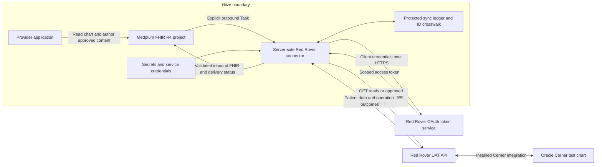
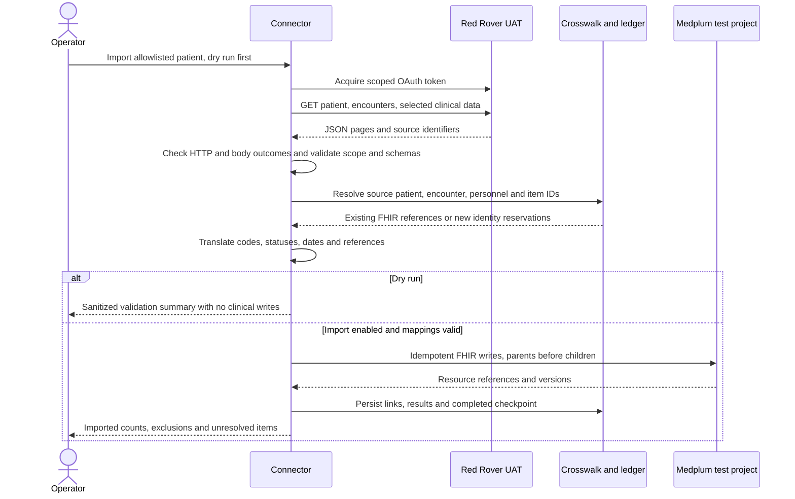
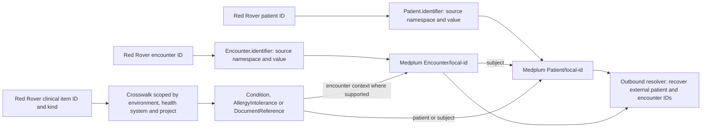
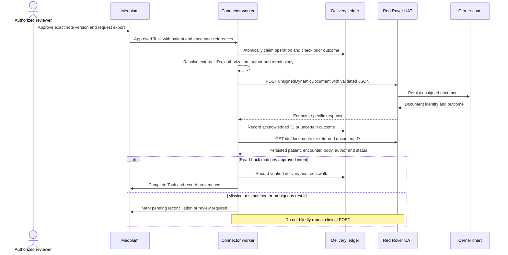
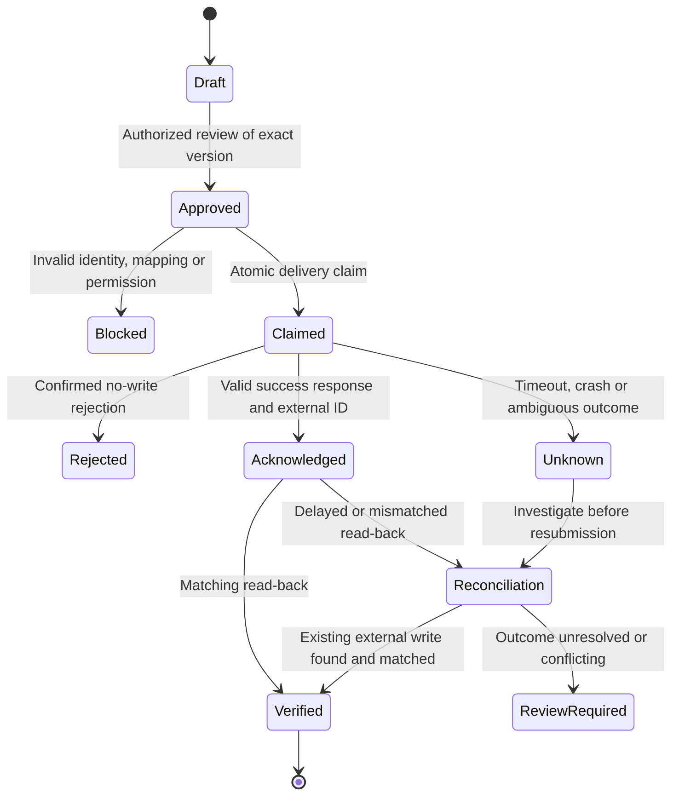

# Red Rover Bidirectional Integration Plan

Status: Partially implemented connector with one verified live read-only UAT patient/encounter test. No Medplum imports or clinical writes performed. API documentation reviewed October 19, 2026.

## 1. What We Are Building

Connect Hiive's Medplum-based application to Oracle Cerner through Red Rover so that we can:

1. **Pull:** retrieve an authorized patient's demographics, encounters, and clinical history from Red Rover and represent them as FHIR R4 resources in Medplum.
2. **Push:** send explicitly approved, supported clinical data created in Hiive back through Red Rover into the patient's Cerner chart.
3. **Verify:** read the submitted record back and track whether it actually reached the intended patient, encounter, author, and clinical status.

**Bidirectional does not mean every field automatically synchronizes both ways.** Reading a patient does not enable demographic updates; importing a diagnosis does not authorize changing it. Each outbound workflow needs its own endpoint, mapping, clinical ownership policy, and acceptance test.

Recommended first round trip: **Red Rover patient and encounter -> Medplum chart -> approved unsigned test note -> Red Rover -> verified Cerner document.** An unsigned note still changes the external chart and requires explicit sandbox-write authorization.

### Evidence Versus Design

| Classification | Meaning |
| --- | --- |
| Documented API capability | Present in the public Red Rover v2 specification; not proof that Hiive's UAT installation supports or grants it |
| Proposed design | Target behavior beyond the offline implementation evidence recorded in section 7 |
| Offline implemented | Unit-tested local transport, patient/encounter mapping, dry run and import/export preparation; not runtime acceptance |
| Runtime verified | One UAT OAuth/patient/encounter read passed on October 19, 2026 under an explicit temporary credential-risk exception; no import, clinical write or outbound read-back performed |

## 2. Connections And Boundaries

The connector translates between Red Rover's endpoint-specific JSON and Medplum's FHIR R4 API. The selected Red Rover endpoints are not a general FHIR server. Credentials and Red Rover calls stay server-side, never in the patient or provider browser.

Both pull and push are initiated by the connector. Bidirectionality does not require Red Rover to call the local machine. Start with manual runs and bounded polling; external webhook support has not been confirmed.

| Connection | Initial testing | Deployment requirement |
| --- | --- | --- |
| Connector -> Red Rover | Local process using actual whitelisted outbound IP | Stable approved egress; a cloud Bot does not inherit the laptop's whitelist |
| Connector -> Medplum | Dedicated integration-test project and service client | Least-privilege AccessPolicy and approved target project |
| Provider application -> Medplum | Existing chart views, subject to their supported resource rendering | Separately implement and authorize any new export action |
| Connector -> ledger | Durable protected state, even for resumable local tests | Persistence, concurrency control, encryption, backups, and retention policy |

The user reports `108.3.159.3` is whitelisted. Verify actual egress before testing, particularly with VPNs or changing networks. Confirm the exact UAT API and token URLs with Red Rover: the OpenAPI `localhost` server is not a deployment address, and previously reviewed guide URLs have an environment-path ambiguity. Do not guess production URLs.

## 3. Pull: Red Rover Into Medplum

### Inbound Mapping Catalog

These are proposed resource-level mappings. Exact JSON property paths, null handling, and terminology translations must be established from the linked domain schemas and authorized UAT fixtures before implementation.

| Red Rover data / example GET path | Proposed Medplum representation | Important mapping rule |
| --- | --- | --- |
| Patients: `/api/v2/patients` | `Patient` | Preserve external ID, aliases and assigning authority; do not match by name alone |
| Encounters: `/api/v2/patients/encounters` | `Encounter` | Resolve `subject`, encounter ID, class, status, period and locations |
| Allergies: `/api/v2/patients/allergies` | `AllergyIntolerance` | Preserve allergen, reaction, verification and cancellation semantics |
| Diagnoses: `/api/v2/patients/diagnoses` | `Condition` with encounter-diagnosis category | Preserve encounter association and diagnosis identity |
| Problems: `/api/v2/patients/problems` | `Condition` with problem-list-item category | Keep separate from encounter diagnoses, even when clinical codes match |
| Appointments: `/api/v2/patients/appointments` | `Appointment` | Resolve participants and map scheduled/canceled statuses explicitly |
| Documents: `/api/v2/patients/documents` | `DocumentReference` and protected content, such as `Binary` | Preserve source document ID, author, content type and document status |
| Personnel: `/api/v2/personnel`; relevant location lookups | `Practitioner`, optionally `PractitionerRole`, and `Location` | Use verified external identities, not display names as keys |
| Observations: `/api/v2/patients/observations` | `Observation` | Later expansion: retain typed values, units, effective times and result status |
| Medication orders: `/api/v2/patients/medications` | Typically `MedicationRequest`; classify source semantics first | Later expansion: do not turn an order into a reported medication or administration |
| Procedures and immunizations | `Procedure`, `Immunization` | Later expansion, separately validated |

Unknown mandatory mappings are quarantined for review, not filled with fabricated clinical defaults. Preserve local code-system identity; add standard codes only when a validated translation exists. Use versioned `ConceptMap` resources where appropriate. Keep birth dates as dates and preserve timestamp precision and timezone semantics.

### Identifier And Reference Mapping

For example, assigned UAT patient `19128435` and encounter `61221038` become a local `Patient` and `Encounter` with their original IDs retained as identifiers. Local FHIR IDs are different identifiers and must never be sent as Red Rover patient or encounter IDs.

Proposed identifier namespaces must distinguish environment, source health system and entity kind, for example `https://example.org/red-rover/uat/site-a/patient`. This is an illustrative namespace, not a registered production identifier system. Final namespaces need an owned, stable naming decision.

The crosswalk key is `(source environment, health system, entity kind, source ID, Medplum project)`. It records the FHIR reference, last successful source revision or normalized digest, mapping version, and synchronization outcome. Identifier-bearing resources remain the clinical identity record; the ledger supports resumability, locking, and delivery reconciliation. For resources without a suitable identifier field, use an explicit crosswalk rather than inventing FHIR properties.

Use conditional creates or equivalent serialized identifier-based upserts, detect multiple matches, and use version-aware updates to avoid overwriting concurrent changes. A crosswalk alone is not a duplicate-prevention guarantee.

### Incremental Retrieval

- Begin with one patient, then the five assigned patients. Do not run unrestricted population discovery.
- For supported activity endpoints, use a fixed upper bound and overlapping retrieval window with deduplication. Persist a checkpoint only after all pages and accepted writes complete; retain explicit failure records for quarantined items.
- Pagination is endpoint-specific. Use `paginationId`, `paginationTimeStamp`, or other controls only where declared. Some reference searches require refining the search instead of paginating.
- Handle inactive, canceled, corrected and deleted states according to each endpoint. Absence from a page is not a deletion signal.
- Use bounded timeouts, rate-limit handling and safe-read retries. Validate response envelopes and per-item outcomes in addition to HTTP status.
- Store FHIR `Provenance` for origin, transformation version and responsible agent. Keep clinical payloads out of ordinary operational logs.

## 4. Push: Medplum Back Through Red Rover

**A generic Medplum resource update must not automatically become an external clinical write.** Proposed trigger: an authorized application action creates an export `Task` referencing a specific immutable resource version and intended operation. Initially an operator approves and dispatches that Task manually. Later a narrowly filtered Medplum Subscription/Bot can dispatch approved Tasks to the worker; delivery events remain at-least-once and require deduplication.

This diagram shows the intended successful sequence. Authentication failure, schema rejection, partial results and timeouts must follow the delivery state model below. API acknowledgement is not the same as verified chart persistence.

### Outbound Capability And Mapping Catalog

All rows are documented API capabilities, **not enabled connector features**. Start with the unsigned-document row only after confirming its schema, permissions and installed support with Red Rover.

| Hiive/FHIR intent | Red Rover operation | Documented scope | Decision / limitation |
| --- | --- | --- | --- |
| New reviewed note content linked by `DocumentReference`, with content retrieved from protected storage | `POST /api/v2/unsignedDynamicDocument` | `rrh/documents:write` | Recommended first write; creates an In Progress, unsigned Dynamic Documentation document |
| Update that existing unsigned dynamic document | `PUT /api/v2/unsignedDynamicDocument` | `rrh/documents:write` | Requires `documentId` and `body`; document must already be unsigned and remains unsigned |
| Other clinical document creation or update | `POST` / `PUT /api/v2/document` | `rrh/documents:write` | POST requires patient, encounter, type code and body; PUT documents CCL 1.4.0+; signed-status policy requires separate approval |
| Encounter diagnosis `Condition` | `POST` / `PUT /api/v2/diagnoses` | `rrh/problemsDiagnoses:write` | POST requires patient and encounter plus diagnosis reference or codes; classify as diagnosis, not problem |
| Longitudinal problem `Condition` | `POST` / `PUT /api/v2/problems` | `rrh/problemsDiagnoses:write` | POST requires patient plus problem reference or codes; independent from diagnosis workflow |
| Validated result `Observation` | `POST /api/v2/observations` | `rrh/observations:write` | Documented for version 1.35.0+; singular `/observation` is deprecated |
| Approved scheduling intent `Appointment` | `POST` / `PATCH /api/v2/appointment` | `rrh/appointments:write` | Documented for version 1.18+; slot, resource and action semantics need separate mapping |
| New patient registration | `POST /api/v2/patients` | `rrh/patientsEncounters:write` | CCL 1.4.0+; excluded initially; create is not a demographic-update contract |

Medication, immunization, order, procedure, PowerForm and document-component writes are outside the initial scope. Their existence in the API does not make them interchangeable with notes or safe generic exports.

Important endpoint semantics:

- `PUT /diagnoses` and `PUT /problems` support update, delete and review actions. Updates require all attributes that should remain, not just changed fields. Keep delete/review actions disabled initially; future updates need current-state retrieval, comparison and conflict handling.
- `POST /document` can fall back to the application's system account if `emrUserId` or `authorId` is omitted. Do not rely on that fallback: explicitly agree attribution with Red Rover. Authenticated status requires matching `emrUserId` and `authorId` according to the endpoint description.
- The request-header `userId` is audit context, not the OAuth credential or automatically the document author. Resolve each identity separately and enforce local authorization before constructing a request.
- Document-component writes can overwrite text when an event ID is supplied, and some components are author-specific. They are not the recommended initial note-export mechanism.

### First Note: Mapping Contract

| Input in Medplum | Outbound conversion / gate |
| --- | --- |
| `DocumentReference.subject` | Resolve to allowlisted external `patientId`; refuse absent or ambiguous crosswalk |
| `DocumentReference.context.encounter` | Resolve the intended external `encounterId`; confirm it belongs to that patient in UAT |
| Protected document content | Retrieve authorized bytes, validate content type, sanitize if rendered, and convert to the exact Red Rover `body` representation |
| Document type / template intent | Resolve environment-specific document and template reference values required by the unsigned-document schema; never send display text as a code |
| Author / approving identity | Resolve approved Cerner personnel identity and required author fields; do not substitute the Medplum practitioner ID |
| Reviewed resource version | Freeze payload and mapping version; any content change invalidates approval and needs a new operation |
| Red Rover response | Validate envelope and item outcomes, capture returned document identity, then read back through `GET /api/v2/ids/documents` |
| Verified external document | Store crosswalk and provenance against the original note; do not import a second independent copy of the same exported note |

This table is a design contract, not a copy-ready request payload. Resolve `postUnsignedDynamicDocumentRequest`, `postDocumentResponse` and `getDocumentsResponse` from the EMR domain before implementing. Confirm actual mandatory fields, content encoding, templates, author permissions, response IDs, visibility delays and read-back filters in UAT.

## 5. Preventing Loops, Duplicates And Lost Updates

Imagine we import a Cerner diagnosis, show it in Medplum, and then observe that Medplum resource change. Re-exporting it would create a loop or duplicate. Origin tracking and explicit export intent prevent that: **an import is never an export request**.

Proposed ownership policy:

| Data | Initial authority | Conflict behavior |
| --- | --- | --- |
| Imported demographics and encounters | Cerner | No automatic reverse edits; mismatches need review |
| Imported clinical facts | Cerner for imported fields | Preserve local additions separately; do not overwrite local edits silently |
| Hiive-authored approved note | Hiive owns the approved version; Cerner owns its external signature lifecycle | Do not overwrite a subsequently signed or externally edited document |
| Export Task and transport state | Connector, within scoped Medplum permissions | Never interpret transport completion as clinical signing |

These are logical delivery states, not literal FHIR `Task.status` codes. Map them to valid Task statuses plus a governed `businessStatus` vocabulary. Do not label unverified delivery as completed.

Required controls:

- Durable uniqueness key: target environment/site, Medplum project, source resource ID and version, and operation type. An update and a create are different intents. Use atomic claiming and per-resource serialization to prevent concurrent sends.
- Record direction, origin, correlation ID, payload digest, approval, mapping version, attempt outcome, external ID and verification evidence. Treat IDs and digests as sensitive metadata; restrict access and retention.
- Internal deduplication does not guarantee exactly-once delivery across Red Rover and Medplum. Do not assume an API idempotency header exists.
- On uncertain POST outcome, inspect the returned ID when available or use a Red Rover-approved reconciliation strategy. If no unique correlation/search mechanism exists, require human/vendor review, not automatic resubmission. A matching body alone is not proof of identity.
- When polling sees an exported record, match its crosswalk and update verified state instead of creating a new local document or export Task. Do not ignore later genuine Cerner changes just because Hiive originally authored the record.
- For future outbound updates, compare current remote state with the last verified baseline. Refuse conflicts; use remote concurrency controls if documented. If none exist, do not claim protection from all read/write races.
- Keep read-back retries bounded to accommodate visibility delays; no retry may silently turn into another clinical create. Restrict automatic write retries to cases proven not to have reached the destination and explicitly allowed by the endpoint contract.

## 6. Sandbox Setup And Safety Gates

### Development Isolation

Implementation branch: `feature/red-rover-integration`, created from freshly fetched `origin/main` at `2da31ebd1`, in the separate sibling worktree `medplum-ubix-red-rover`. The existing checkout and unrelated authentication edits are preserved. No integration commits or pushes have been made.

Keep the connector near the existing integration examples under `examples/medplum-demo-bots`, with a local server-side runner for initial egress testing and reusable mapping modules. Prefer Medplum-native Tasks, Provenance, AccessPolicies, ConceptMaps and later Subscriptions/Bots; add only the custom translation and durable delivery behavior they do not supply. No shared Medplum server changes are required initially. The durable ledger implementation is a Slice 1 design decision, not an existing service.

### Configuration Requirements

- Rotate the plaintext client secret previously identified in the starter collection before use. Do not commit or reproduce that collection with credentials intact.
- Temporary owner-authorized exception: the user explicitly accepted continued use of the existing secret for read-only UAT testing. The runner supports a per-invocation exposure acknowledgment expiring within 15 minutes, restricted to the documented UAT hosts. Rotation remains unconfirmed and recommended; writes, imports, production and unattended operation remain excluded. This exception does not restore credential secrecy or change any other access gate.
- Configure confirmed UAT API/token URLs, client ID/secret, approved scopes, audit `userId`, authorized author identities, site/facility context, cohort allowlist, and a dedicated Medplum test-project client.
- Default both Medplum import and Red Rover clinical writes to disabled; dry-run mode permits necessary OAuth token POSTs but no clinical mutations.
- Gate writes with the expected environment, project, endpoint, operation, patient/encounter pair and explicit approval. A broad write scope alone is insufficient authorization.
- Use HTTPS, secure secret storage, bounded requests and least privilege. Keep token/body/header dumps and Red Rover debug output disabled. Any retained UAT fixtures must be authorized, protected and excluded from source control unless demonstrably sanitized.
- Do not use production clinical data or existing demo charts as an implicit integration-test environment. Confirm patient-data access/consent policy and audit requirements before expanding beyond assigned UAT records.

### Assigned Starter-Kit Cohort

Reconfirm this assignment with Red Rover before use. An assigned encounter must still be checked against its patient's live UAT record before any write.

| Test patient | Patient ID | Encounter ID |
| --- | --- | --- |
| RRHII, TESTONE | `19128435` | `61221038` |
| RRHII, TESTTWO | `19128437` | `61221039` |
| RRHII, TESTTHREE | `19128439` | `61221040` |
| RRHII, TESTFOUR | `19128441` | `61221041` |
| RRHII, TESTFIVE | `19128443` | `61221042` |

Stop sends immediately with a write-disable switch if identity, attribution or duplication checks fail. Pausing the connector does not undo remote writes. Agree test-record cleanup/correction procedures with Red Rover; do not assume clinical records can be deleted as rollback.

## 7. Implementation Work Slices

Slices are ordered by dependencies and verified outcomes, not calendar estimates. Use bounded AI-agent implementation slices with human approval of clinical mappings and external mutations. Offline portions of slices 1-6 are implemented as recorded below, and one bounded live read is verified. Remaining clinical, import, recovery and write-back gates are incomplete; slice 7 has not begun.

| Slice | Scope and deliverable | Verification / exit gate |
| --- | --- | --- |
| 1. Isolate and configure | Separate branch/worktree, ignored configuration, isolated project, durable ledger choice, capability matrix and secret rotation | No credentials in git; environment/cohort enforcement tests reject invalid targets; URLs, scopes and author policy confirmed |
| 2. Connect read-only | Local OAuth client, actual egress verification, GET one assigned patient | Valid scoped token and expected patient ID; sanitized diagnostics; no clinical writes in either system |
| 3. Retrieve safely | Patient/encounter and selected allergy, diagnosis, problem, appointment and document reads | Endpoint schemas resolved; pagination, envelope failures, cancellation and token-expiry tests pass; no unexpected patients |
| 4. Map and dry-run | FHIR transforms, identity crosswalk, terminology decisions and validation summary | FHIR validation and reference tests pass; unknown mandatory values quarantined; zero clinical writes |
| 5. Import idempotently | One patient, then assigned cohort, into isolated Medplum project | Replay yields no duplicates; all references resolve; checkpoint recovery works; verify intended resources and supported provider views |
| 6. Prove write-back | Approved unsigned note export, durable claim, read-back and loop prevention | Explicit sandbox approval; one external document on correct patient/encounter; unsigned status and agreed attribution verified; redelivery adds no second document |
| 7. Expand and deploy | Separately approved diagnoses/problems or other workflows; stable cloud egress, secrets, monitoring and runbook | Per-workflow acceptance tests, conflict/recovery drills and clinical sign-off; cloud IP approved; production remains gated until separately authorized |

### Offline Implementation Evidence

Code is in the feature worktree under `examples/medplum-demo-bots/src/red-rover/`; its README contains the runnable offline file workflow and detailed limitations.

- **Isolation/configuration:** UAT-only OAuth transport and an assigned patient allowlist; clinical-write mode rejected. Credentials remain outside source control.
- **Retrieval:** checked single-patient and patient-scoped encounter reads; failed envelopes, count inconsistencies, repeated IDs, wrong patients and non-advancing cursors rejected. Multi-page reads require explicit site confirmation of ascending ID ordering. Other clinical reads are not implemented.
- **Guarded sandbox runner:** no-network private-configuration preflight and explicitly authorized read-only execution are implemented. The runner requires read-access confirmation plus either rotation confirmation or the temporary UAT credential-risk acknowledgment, owner-only files/directories, a new protected output and a verified expected patient/encounter pair. Failed reads do not produce a completed snapshot. Offline tests use mocked transport; the separate live evidence follows below. The connector README documents configuration and commands.
- **Mapping/dry run:** deterministic source-scoped patient/encounter identities, explicit code maps, date checks, native FHIR validation, Provenance and protected file output. Unsupported fields are reported; confidentiality/VIP controls are quarantined. No approved site terminology maps or live fixtures are supplied.
- **Import preparation:** conditional-create transaction proposal with fullUrl reference rewriting and an exact-plan, version-guarded native Task ledger. No executor, persisted crosswalk, checkpoint recovery or verified concurrency/rollback guarantees. The future executor must independently verify project identity, inspect every response and reconcile existing/partial records.
- **Export preparation:** exact-version note approval checks, explicit author/template/type settings and base64 XHTML conversion for unsigned Dynamic Documentation. Pure delivery transitions forbid blind uncertain-write retries and require read-back evidence. No clinical sender, durable delivery adapter, live read-back or subscription loop prevention.

Offline unit tests, focused TypeScript and scoped lint validate these local components. They do not establish end-to-end delivery. Beyond the bounded read-only exception, runtime continuation requires appropriate credential handling, approved clinical/security mappings, an isolated project with protected durable state, transaction/concurrency recovery evidence and explicit sandbox-write approval.

### Live Read Evidence

- At `2026-10-19T18:57Z`, one owner-authorized attempt returned HTTP 200 for OAuth, patient retrieval and encounter retrieval. The token/body/credentials were not printed. No automatic retry was used.
- Patient `19128435` and its expected encounter `61221038` were verified, with exactly one returned encounter. This does not prove multi-page traversal, other endpoints or the remaining cohort.
- A completed snapshot was saved outside source control with file permissions `600` in the private Red Rover configuration directory. Only counts and sanitized request outcomes were printed.
- The existing credential was used under an explicit 10-minute exposure acknowledgment. The saved rotation flag remained `false` and writes remained disabled. The exception does not revoke the exposed credential or authorize imports, clinical writes or deployment.
- No Medplum resource, Red Rover clinical record, AWS resource or deployed application was changed by this read.

### Saved-Snapshot Mapping Review

- At `2026-10-19T19:06Z`, the completed private snapshot was reviewed offline with network access disabled. An owner-only review artifact was saved outside source control. No additional Red Rover call, FHIR import or clinical write occurred.
- The draft contains one Patient, one Encounter and one Provenance; base-R4 validation returned no issues, and Patient/Encounter/Provenance references were checked. This is not clinical, terminology, local-profile or security-policy approval.
- Three display-derived terminology proposals remain explicitly unapproved. Missing source birth date remains absent; it was not inferred from age. Twenty-two unmapped root fields remain, including military data, aliases, locations, encounter admission/discharge information and coverage.
- Source confidentiality/VIP codes are preserved as local Patient security labels only in this review projection; they do not enforce access or establish approved security translations. The strict import mapper still quarantines these controls. Provenance fingerprints the full original snapshot, including fields omitted from the draft.
- Every draft resource is tagged `review-only-not-for-import`, uses a placeholder namespace and unprovisioned actor, and remains blocked by the import-plan boundary. Four blocker categories remain: terminology approval, confidentiality/VIP enforcement, real namespace/actor provisioning, and disposition of unmapped fields. Date semantics also require clinical approval.
- Current verification: 132 connector tests across nine files, focused strict TypeScript and scoped lint pass (copyright-header rule excluded). Import/export executors, protected durable state and live recovery/write-back acceptance remain incomplete.

### Required Failure Tests

- Wrong patient/encounter pairing, missing crosswalk, ambiguous identity and wrong environment/project block before sending.
- Imported resources and connector status updates do not produce export Tasks.
- Duplicate Tasks, concurrent workers, process crashes and redelivery do not automatically produce duplicate clinical POSTs.
- HTTP 200 with a failed envelope or failed item is not success; partial batches reconcile per item.
- Timeout after destination persistence enters uncertain-outcome handling; it does not resend blindly.
- Read-back mismatch, delayed visibility and remote edits remain pending/review-required rather than falsely completed.
- Changed note content invalidates its prior approval. Signed or externally changed documents are not overwritten.
- Repeated imports preserve source identity and do not erase local clinical additions or silently advance past untracked failures.

### End-To-End Acceptance Scenario

1. Pull UAT patient `19128435`, verify encounter `61221038`, then dry-run selected chart mappings.
2. Enable import into the isolated project; verify the resulting patient, encounter, references and selected chart data. Replay and confirm no duplicates.
3. Create a clearly labeled sandbox test note in Medplum, review its exact content/version, and explicitly approve a single unsigned-document export.
4. Verify the external document ID, patient, encounter, content, unsigned status and agreed author through Red Rover read-back. Confirm chart visibility with Red Rover or an authorized Cerner reviewer.
5. Re-deliver the same Task and poll the external chart again. Confirm one external document, one linked local note and no new export triggered by read-back.

## 8. Decisions Needed Before Live Testing

| Question | Required answer / owner |
| --- | --- |
| Which UAT API and OAuth token URLs are authoritative? | Red Rover environment owner; resolve guide/specification discrepancy |
| Is the client secret rotated, and is current egress approved? | Hiive credential owner and Red Rover |
| Which read/write scopes and installed Core/CCL versions apply? | Red Rover capability matrix for this installation, not just public API version 2.0 |
| Is unsigned Dynamic Documentation enabled for Hiive? | Red Rover: required templates, document type, author identities, allowed patient/encounter and read-back support |
| How are ambiguous creates uniquely reconciled? | Red Rover: response ID guarantees, searchable correlation support and operator process |
| Which fields may Hiive create or change? | Clinical owner: per-workflow authority, approval, signature and conflict policies |
| Which Medplum project and ledger storage are approved? | Hiive: project ID, least-privilege client, durable state and retention controls |
| What is an acceptable polling interval and retrieval window? | Red Rover: limits, visibility delays, timestamp precision and retention behavior |
| How are test writes corrected or cleaned up? | Red Rover and clinical owner; no assumed automatic rollback |

## 9. References

- [Red Rover API v2 reference](https://app.swaggerhub.com/apis-docs/RedRover/RedRoverAPIs/2.0)
- [Red Rover API v2 OpenAPI specification](https://api.swaggerhub.com/apis/RedRover/RedRoverAPIs/2.0)
- [Red Rover EMR domain schemas](https://api.swaggerhub.com/domains/RedRover/EMRDomain/1.0)
- [Red Rover Core domain schemas](https://api.swaggerhub.com/domains/RedRover/CoreDomain/1.0)
- Supplied Hiive Health Postman starter collection and quick-start guide, retained outside source control; environment details require confirmation.
- [Medplum Bot conventions in this repository](examples/medplum-demo-bots/README.md)
- [Medplum FHIR R4 API reference](https://www.medplum.com/docs/api/fhir/)

The diagrams describe the target design and render in a Mermaid-capable Markdown preview. They do not represent deployed connections or completed integration tests.